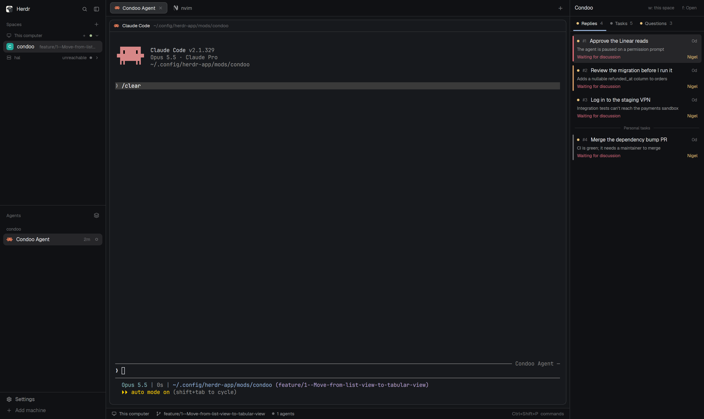
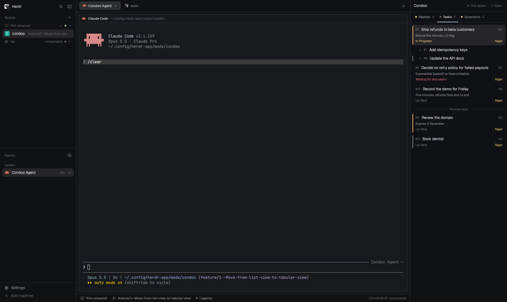

# Condoo

[](https://github.com/NigelGreenway/condoo/releases)

A silly combining of the words **Context** and **Todo.**, this mod is a list for everything your coding agents need from you: their
questions, their requests, and your own tasks.

## What this is

The problem I was finding when starting to get into agentic workflows, across multiple domains; was lacking in context, having tasks I needed to do (and multiple tasks from one agent), as well as having to answer the dreaded list of questions - all in one prompt!

So, being [Herdr](https://herdr.dev) is my first introduction to an Integrated Development Environment [ADE] and starting to understand the problem space more, I developed a proof of concept to see if I could solve my problem.

This is it!

## What this is **not**

A way to replace any task list outside of what your agents are doing locally. This is a local only task list with the ability to store the context outside of your brain as we are not built to multi-task.

## How does it work?

Agents add items with the `condoo` command; you see and answer them in a panel in [Herdr](https://herdr.dev). An answer is typed straight back into the agent that asked.

# Setup

Runs on Linux, macOS and Windows via a single binary built with Go

## Install

**Linux and macOS**

```sh
curl -fsSL https://github.com/NigelGreenway/condoo/releases/latest/download/install.sh | sh
```

**Windows** (PowerShell)

```powershell
& ([scriptblock]::Create((irm https://github.com/NigelGreenway/condoo/releases/latest/download/install.ps1)))
```

Running the installer will ask you the following inputs:

1. Where the `condoo` command goes. The defaults:
    Linux/macOS: `~/.local/bin`
    Windows: `%LOCALAPPDATA%\Programs\Condoo`
2. Whether to add that folder to your `PATH`:
    Linux/macOS: It will print the line to add and will never edit your shell files
    Windows: It can add it to your user `PATH`.
3. Your name on the list. This defaults to your login name.
4. Whether to install the Herdr panel.

From a checkout with Go installed, `sh install.sh` (or `.\install.ps1`) builds the CLI from source instead of downloading. `--help` lists the options, including `--yes` for no questions.

### Upgrading

Run the installer again. It replaces the program in place, and the link and the panel keep
working. Your list is upgraded the next time anything runs `condoo` (you, an agent or the
panel); there is no separate step. Each change to the database is applied in order, and in
its own transaction, so one that fails leaves the list as it was and is tried again next
time. An older `condoo` refuses a list a newer one has upgraded, and says to upgrade.

## Set up in Herdr

1. **A key for the panel.** In the `"global"` section of your Herdr `keys.json` (any free key):

   ```json
   "ctrl-a /": "mod.open:condoo"
   ```

   The key opens the panel as a dialog.

2. **Optional: a sidebar.** Ask your agent in Herdr: *"add a sidebar on the right for
   Condoo"*. Any layout block showing the `condoo` mod becomes the panel, and the key then
   slides it in and out.

3. **Tell your agents.** Copy [`AGENTS-snippet.md`](AGENTS-snippet.md) into your
   `CLAUDE.md`, `AGENTS.md` or equivalent. It tells agents to put their questions in Condoo
   when they have more than one.

## Using the panel

There are three tabs; **Replies** (agents' requests), **Tasks** (your own) and **Questions**. 

### Replies

If your agent needs your attention from the prompt, they will sit here.



### Tasks

You can ask your agent to assign tasks for you - whether this is from planning sessions, general discussions, or you can add your own you your own reminders. To enrich these further, you can add comments and assign the task back to the agent.



### Questions

If your agent needs questions answering, they will be added here. This is useful for when the agent throws loads of questions at your, but you might not be able to answer straight away, but need the agent to do other stuff.


Each tab displays a dot. It's coloured grey to show it has open items, and yellow when something is new. This could be a new item - or a comment, from the agent.

Closing a space never hides its items. They move under **Detached Spaces**, which are shown in every space and tagged with the old name. Open a space with the same name again, and they go back into the designated space. `m` moves an item to any space, or to Personal.

| Key | Does |
|---|---|
| `j` `k` | move |
| `[` `]` | previous / next tab |
| `enter` | answer a question in your editor, go to a request's agent, or edit a task |
| `a` | add an item; `>` adds a sub-task |
| `space` | show the description and comments |
| `c` | comment on an item in your editor |
| `s` `p` | change status / priority |
| `m` | move to another space |
| `f` | filter: open, each status, all |
| `x` | delete |
| `?` | every key |

A yellow megaphone marks an item with comments: faint once you've read them, bright when an agent has commented since you last opened it. Your comment is also typed into the item's agent if it's idle.

Answers and comments open in `$VISUAL` or `$EDITOR`. Without one set: `vim`, `vi` or `nano`, or on Windows `edit`, `nvim`, `vim`, `nano` or `notepad`, whichever is found first.

## The command

```sh
condoo ask "What is required to do for this?" -s "one-line summary" \
  -d "full context and options" --agent "Claude (TICKET-123)" --priority high
condoo request "Approve the Linear reads" --agent "Codex (t2r)"
condoo add "Review the migration"          # one of your own tasks
condoo list                                # everything, as JSON
condoo get 12                              # one item, with its answer
condoo set 12 --status completed
condoo comment 12 "Done for menu-service" --agent "Claude (TICKET-123)"
condoo comments 12                         # its comments (get includes them too)
condoo move 12 --space <space id>          # with its sub-items; --space "" for none
condoo --help
```

Every command prints JSON. Inside Herdr, the agent's terminal is recorded from `$HC_TERMINAL_ID`, so answers can be sent back to it.

## Settings

```sh
condoo config                      # your name, the database, and where each came from
condoo config set name "Ada"
condoo config set db "~/Dropbox/condoo.sqlite"
condoo config set name ""          # back to the default
```

Environment variables override the config file: `CONDOO_NAME`, `CONDOO_DB`, `CONDOO_CONFIG`.
`CONDOO_AGENT` sets the default `--agent`.

## Where things live

| | Linux | macOS | Windows |
|---|---|---|---|
| Database | `~/.local/share/condoo/condoo.sqlite` | `~/Library/Application Support/Condoo/condoo.sqlite` | `%LOCALAPPDATA%\Condoo\condoo.sqlite` |
| Settings | `~/.config/condoo/config.json` | `~/Library/Application Support/Condoo/config.json` | `%APPDATA%\Condoo\config.json` |
| Program | `~/.local/share/condoo/bin/condoo`, linked from your chosen folder | `~/Library/Application Support/Condoo/bin/condoo`, linked | your chosen folder |
| Herdr panel | `~/.config/herdr-app/mods/condoo` | same | same |

On Linux, `XDG_DATA_HOME`, `XDG_CONFIG_HOME` and `XDG_CACHE_HOME` are honoured.

## Uninstall

```sh
sh install.sh --uninstall          # Windows: .\install.ps1 -Uninstall
```

It removes the program, the link and the panel, and keeps your list and settings (it prints
where they are).

## Development

```sh
go test ./...                      # the command's tests
node --test test/*.test.mjs        # the panel's space matching
go build ./cmd/condoo
herdr-app check mods/condoo         # the panel
```

**Changing the database.** Append a step to `migrations` in `internal/store/store.go`;
`migrations[i]` takes the schema from version `i` to `i+1` (SQLite's `user_version`). Never
edit or reorder a released step: write the new one against the schema the last one left.
A step that rebuilds a table others reference (create, copy, drop, rename) sets
`foreignKeysOff: true`, or dropping the old table deletes the rows that point at it. Add a
test in `internal/store/store_test.go` that opens a database at the previous version.

CI runs the tests and an install, upgrade and uninstall on Linux, macOS and Windows. Pushing a `v*` tag builds every binary, runs each on its own OS, and attaches them to a GitHub release with `checksums.txt` (see `.github/workflows/release.yml`).

## Licence

Condoo is free software: you can redistribute it and/or modify it under the terms of the [GNU General Public License v3.0](LICENSE) as published by the Free Software Foundation.
