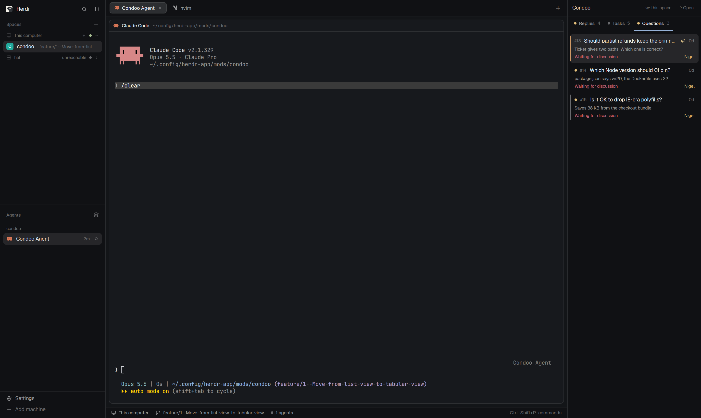

# Condoo

A keyboard-driven panel in Herdr for everything your coding agents need from you. Agents put
their questions and requests in it with the `condoo` command instead of asking several in
their terminal. You also keep your own tasks there. Press Enter on a question and your editor
opens; when you save and quit, the answer is stored and typed into the agent that asked. The
panel opens as a dialog, or slides in as a sidebar if your layout has a block for it.

## What you see

The panel is one column on Herdr's `chrome` background, 340px wide as a sidebar (260–640px,
resizable) or a 420px × 85% dialog.

- **Header bar** (36px, a 1px `border` line under it): "Condoo" at 13px semibold, in
  `foreground` while the panel has the keyboard, `muted` otherwise. On the right are three 11px
  chips in `dim`, each on a `raised` background with 4px corners while its setting is
  non-default:
  - `w: this space (+3)`: the `+N` counts open items in other spaces. Toggled on, it reads
    `w: all spaces`.
  - `f: All`, or the status being filtered on, in that status's colour.
  - `c: done hidden` / `c: done shown`.
- **Three sections**, always in this order:
  1. **Needs your reply**: agents' requests.
  2. **My tasks**: your own.
  3. **Questions**: agents' questions to answer in writing.

  Each has a 10.5px semibold uppercase heading (`dim`, or `muted` for the section the cursor
  is in) followed by its count of open items. An empty section shows one 11.5px `dim` line:
  "Nothing waiting on you", "No tasks. Press a to add one" or "No open questions".
- **Items** are rows with 6px corners and a 6px margin each side:
  - **Left edge:** a 3px stripe for priority: urgent `#e06c75`, high `#d19a66`, low `dim`,
    none for normal.
  - **Line 1:** the title, 13px medium. On the right of the same line: the days since the
    last status change ("3d", 11px at 40% opacity).
  - **Line 2:** the summary, 11px `muted`.
  - **Answered questions** add "↪" and the answer's first line, 11px `dim`.
  - **Bottom line, 11px:** the status, then the person it's waiting on in yellow, pushed to
    the right.
  - **Status colours** (dark theme): Waiting for discussion `#c4677a`, In Progress
    `#e5c07b`, Up Next foreground at 40%, Completed `#98c379`, Cancelled `#e06c75` with
    the title struck through. Light themes use `#800000`, `#9a7212`, `#3f7d2c` and
    `#b8323a`; the orange is `#b5651d`.
  - **Space tag:** in the all-spaces view, an item from another space carries that space's
    name in a small `raised` chip.
- **Sub-items** are indented 14px per level with "↳". They show only their title until
  hovered, selected or opened. A folded parent shows a `+N` chip.
- **Personal tasks and Detached Spaces:** in each section, below the current space's items,
  thin dividers ("Personal tasks", then "Detached Spaces", 10px `dim` text between 1px
  `border` lines) group the items that show in every space. Personal tasks have no space.
  Detached items belonged to a space that's now closed and carry a `was: condoo` chip.
- **Selection:** the selected row is `selected` while the panel has the keyboard, `hover`
  otherwise. Rows that match no filter but have matching sub-items show at 45% opacity, for
  context.
- **Space** opens the item's description under it: markdown in a `background` box with a 1px
  `border`, selectable. "No description. Press e to add one." when empty.
- **Add and edit** use an inline form in a `surface` card with an `accent` border. It has
  four fields (Title, Summary, Description, Waiting on) on `background` inputs, each with a
  `accent` border while active. The description grows from 6 to 18 rows.
- **Answer dialog:** a modal 60% × 60% of the window.
  - At the top, a 30px bar: "Answer" in semibold `muted`, the question, "for <agent>", and a
    hint. The hint is ":wq saves · :q! cancels" for vim and similar, otherwise "save and
    quit the editor to send".
  - Below it, your editor in a live terminal.
- **Move picker (`m`):** a dialog 360px wide (taller with more spaces, up to 520px).
  - Top: "MOVE TO" (11px semibold `muted`) and the item's title.
  - Then one 30px row per open space in Herdr's order, with its machine name in `dim` for
    remote spaces, and last "Personal · every space". `accent` "now" marks the current space.
    The picked row is `selected`.
  - Footer: "j k move · enter moves it and its sub-tasks · esc cancels".
- **`?` help:** a 560px × 80% dialog listing every key by group. It names whichever key is
  bound to `mod.open:condoo`.

## How it behaves

- **The toggle key** (`mod.open:condoo`):
  - In a layout with a block showing the `condoo` mod, it shows and focuses that block, or
    hides it and gives the keyboard back to the pane.
  - Without such a block, it opens or closes the panel as a dialog.
- **Agents add items** from their terminal: `condoo ask "title" -s summary -d description
  --agent "Claude (task)" --priority high`, or `condoo request ...`. Their terminal address
  comes from `$HC_TERMINAL_ID`. Each item is filed under the Herdr space that terminal is in.
- **Which space an item belongs to**, in order:
  1. Where its agent's terminal is now, if still open.
  2. The space stored with it, if that's open.
  3. An open space on the same machine with the stored name. A space closed and opened again
     gets a new id but usually the same name (its repo or folder), so its items go back in by
     themselves.
  4. Otherwise Detached Spaces, shown in every space.

  Items with no space are personal and show in every space.
- **Closing a space never hides its items.** Nothing is deleted, and nothing pops up: they
  move to Detached Spaces until a space with that name is open again, or you move them.
- **Keeping up with spaces:** on each reload, the panel stores an open space's current name
  on its items (renames), and a reopened space's new id on items matched by name. Only once
  that machine's spaces have loaded.
- **Refresh:** the list reloads every 4 seconds, but only while the panel is shown and you're
  not editing. `r` reloads at once.
- **Keys** (the panel must have the keyboard):
  - **Moving:**
    - `j`/`k` or the arrow keys move; `g`/`G` go to the first/last item.
    - `[`/`]` jump to the previous/next section, landing on empty ones too.
    - `space` opens or closes the description; `l` folds or unfolds an item's sub-items.
  - **Enter:**
    - On a question: the answer flow (next bullet).
    - On a request with a terminal: `agent.focus` on the agent.
    - Otherwise: edit the item.
  - **Changing items:**
    - `a`/`o` add an item: a question in Questions, otherwise one of your tasks. `>` adds a
      sub-item, which takes its parent's kind and space.
    - `e` edits. In the form, `tab`/`shift-tab` move between fields, `enter` goes to the next
      field (a new line in Description), and `esc` saves. A new item without a title isn't
      added.
    - `s`/`S` step the status forward/back: discussion → in_progress → up_next → completed →
      cancelled. Changing the status resets the age.
    - `p`/`P` step the priority: urgent → high → normal → low.
    - `m` opens the move picker for the item (from a sub-item, its top-level parent).
      `j`/`k` or click pick a space; Enter moves the item and all its sub-items there
      (`condoo move`), and the panel reloads. "Personal" removes the space.
    - `x` asks `Delete "…"? (y/n)` in red. `y` deletes the item and its sub-items.
  - **View:**
    - `w`: this space / all spaces.
    - `f`: cycle a status filter.
    - `c`: show/hide completed and cancelled.
    - `w`, `f`, `c` and folds are remembered per panel.
  - **Leaving:** `?` opens the help. `q` hides the panel. `esc` gives the keyboard back to the
    pane and keeps a sidebar open; a dialog it closes, like `q`.
- **Answering:**
  1. `condoo answer-file N` writes a draft: the current answer, a cut line, and the question
     as `#` comments under it. It also returns the editor to use: `$VISUAL`, `$EDITOR`, else
     `vim`/`vi`/`nano`, or on Windows `edit`/`nvim`/`vim`/`nano`/`notepad`.
  2. The editor runs as a core terminal (`hc run --bg --no-parent`) inside the answer dialog,
     and the panel watches it every 400ms.
  3. When the editor exits, `condoo answer-save N` keeps the text above the cut line. If
     it's empty or unchanged, nothing is saved ("No answer saved" toast). Otherwise the
     question becomes completed and waits on the agent.
  4. If the asking terminal is still open and idle, `hc send --if idle` types in
     `Answer to your question (condoo #N) "title":` and the answer ("Answer sent to …"
     toast). If it's busy: "Answer saved, not sent", and the agent can read it with
     `condoo get N`.
- **Agent statuses** (working, blocked, done, idle) aren't shown: the panel lists items, not
  agents. A request's Enter takes you to its agent, and Herdr shows that agent's status there.
- **Errors** (no `condoo`, an unreadable database) show as a red 11.5px line under the
  header, or as a Condoo toast for a failed change.

## Built from

**`mods/condoo/`** (`main.js`, `mod.json`). `mod.json` is
`{"place": "none", "title": "Condoo", "focusable": true, "overlay": {"kind": "popup", "width": 1, "height": 1}}`.
One `View` class plays several roles, chosen by `props()`:

- **Panel:** in a layout block, or `role: "panel"` in a dialog.
- **Toggle:** opened by `mod.open:condoo` with `props().overlay` and no role. It closes
  itself at once, then shows or hides the block, or opens or closes the dialog.
- **`role: "answer-bar"`:** the bar above the editor. Its props are `title`, `agent`,
  `terminal` and `editor`.
- **`role: "help"`:** the key list.
- **`role: "move"`:** the move picker. Its props are `task` (a top-level item's id), `title`
  and `space` (where it shows now).

**`mods/condoo/spaces.js`** holds `spaceIndex(spaces, panes, machines)`, the matching rules
above. It's pure, so it's tested with Node (`test/spaces.test.mjs`) without Herdr. `of(item)`
returns a space id, `null` (personal) or `DETACHED`; `fix(item)` returns what to store
(`{space_name}` or `{space}`), or `null`. Remote space ids are `<machine>/<id>`; names only
match on the same machine.

The panel finds its block by `content.mod === "condoo"` anywhere in `layout()`, including
`floating`. Any id works, but the block must have one for `layout.show` / `layout.hide`. An
example block:
`{"id": "condoo", "type": "block", "content": {"mod": "condoo"}, "size": {"px": 340}, "min": 260, "max": 640, "hidden": true, "background": "chrome"}`.

- **`herdr` functions:**
  - **Data:** `props`, `theme`, `settings` (`dark`), `layout`, `focused`, `keys`, `spaces`,
    `machines` (only a `ready` machine's missing space counts as closed),
    `panes` (terminal → tab → space), `terminals` (is the editor still live).
  - **Running things:** `exec`, `hc`, `appHome`, `home`, `readTextFile`.
  - **Overlays and messages:** `openOverlay`, `closeOverlay`, `notify`, `nextCommand`
    (`"focus"`).
  - **Shared state:** `shared` / `setShared`. `condoo.focus` holds a timestamp asking the
    panel to take the keyboard; `condoo.dialog` holds the open dialog's id; `condoo.reload`
    holds a timestamp asking every panel to reload after a move.
- **`gpui-base`:** `InputState`/`Input`, `TextareaState`/`Textarea` (auto-grow 6–18),
  `TextView.markdown`, `ScrollHandle` (`scroll_to_item` keeps the cursor visible).
  `localStorage` holds `filter`, `showClosed`, `allSpaces` and `folded`.
- **Commands it runs:** `layout.show`, `layout.hide`, `pane.focus`, `agent.focus`.
- **Programs it runs:**
  - `condoo`: the path in `mods/condoo/bin.json` (`{"path": …}`, written by the installer),
    else `condoo` on PATH.
  - `hc run`, `hc send`.
  - The editor.

**The `condoo` command** (Go, `cmd/condoo` and `internal/`, pure-Go SQLite
`modernc.org/sqlite`) prints one JSON value per call. Errors are printed as `{"error": …}`
with exit code 1, or 2 for a misused command.

- **What the panel calls:**
  - `list` → `{db, name, now, tasks: [...]}`
  - `add` (with `--space` and `--space-name`); `set-json ID '{…}'`; `delete ID`
  - `move ID --space ID --space-name NAME`: the item and its sub-items; `--space ""` for none
  - `answer-file ID` → `{path, editor: [argv]}`; `answer-save ID PATH`
- **What agents call:** `ask`, `request`, `get`, `set`, `move`.
- **Table `tasks`:** `id`, `parent_id` (cascade delete), `kind` (request | task | question),
  `title`, `summary`, `description`, `status`, `priority`, `waiting_on`, `agent`, `terminal`,
  `space`, `space_name` (the space's name when last seen), `answer`, and `created_at` /
  `updated_at` / `status_since` as float Unix seconds. A sub-item takes its parent's space and
  name. Older databases gain missing columns when opened.
- **Settings:**
  - **Name:** `CONDOO_NAME` > `config.json` `name` > the login name, with `DOMAIN\`
    stripped.
  - **Database:** `CONDOO_DB` > `config.json` `db` > the OS data folder (Linux
    `~/.local/share/condoo`, macOS `~/Library/Application Support/Condoo`, Windows
    `%LOCALAPPDATA%\Condoo`).
- **Space lookup:** `herdr-app ls`, matching the terminal or any sub-agent; it gives the
  space's id and name. `--space` without `--space-name` looks the name up there too.

**Also in the repo:**
- `install.sh` / `install.ps1`
- `AGENTS-snippet.md`: what to add to `CLAUDE.md` / `AGENTS.md`
- `keys.json`: the suggested toggle key
- `.github/workflows`: tests on three OSes, and releases with checksums

## Watch out

- **Opening the panel dialog:** `mod.open` opens the mod as an overlay, so the toggle is a
  1×1 popup (`mod.json` `overlay`) that closes itself in `init`. The panel dialog it opens is
  a different copy, so focus is handed over through the shared `condoo.focus` timestamp. The
  panel focuses itself 30ms after seeing a new one under 5 seconds old.
- **Esc in the dialog:** the panel handles Esc itself (in a sidebar it only returns the
  keyboard) and stops it, so Herdr never sees it. As a dialog, the panel closes itself on
  Esc. `close()` also clears `condoo.dialog` however the dialog goes, otherwise the next key
  press would close a dialog that's already gone and do nothing.
- **Shipped layouts are read-only.** A sidebar needs a cloned or personal layout; ask the
  agent: "add a sidebar on the right for Condoo".
- **Herdr has no hooks for a space closing,** and `space.close` uses Herdr's own
  confirmation. So nothing can warn before a close; the panel only sees spaces disappear.
  That's why items are never hidden: Detached Spaces and the name matching do the work.
- **Spaces that look closed but aren't:** at startup, and while a remote machine is offline,
  its spaces are missing from `spaces()`. Items still show (under Detached Spaces), but
  `fix()` stores nothing until `machines()` says that machine is `ready`. Otherwise an
  offline machine's items would move to a local space with the same name.
- **Name matching is a guess:** two open spaces with the same name take items by order (the
  first wins), and a space named differently on reopening won't match; `m` fixes either.
- **PATH:** `exec` uses the login shell's PATH. If `condoo` is in a folder only added in an
  interactive shell file, the panel can't find it, so the installer writes `bin.json`.
- **No `sh -c`:** the editor is started from the argv `condoo` returns, so Windows works.
  `$EDITOR` values with arguments or quotes (`code --wait`, `"C:\Program Files\…"`) are split
  by `condoo`. An editor that returns at once (a GUI editor without its wait flag) cancels the
  answer, because the draft is read unchanged.
- **Undelivered answers:** answers are only typed into an idle agent; a busy one gets a toast
  instead and must `condoo get N`. Messages include `(condoo #N)` so agents can match them.
- **Polling:** reload is a 4s timer that runs only while the panel is shown. Don't make it
  faster: every redraw redraws the window.
- **Key choice:** `ctrl-a` chords take `ctrl-a` (start of line) from shells, so suggest a
  key that's free for most people.
- **`herdr-app check` covers only the first render.** Try the answer dialog, the help and both
  panel forms (block and dialog) in the app.
- **Not yet tried:** the panel on Windows and macOS, and `install.ps1` outside CI.

## Done when

- `go test ./...` passes, and `herdr-app check mods/condoo` prints `check passed`.
- `condoo ask "Test?" -s "one line" --agent Test` prints the item with `kind: "question"`,
  `status: "discussion"` and `waiting_on` set to your name. Run inside Herdr, the item also has
  the terminal's `space`.
- With the toggle key bound and no `condoo` block in the layout, the key opens a 420px dialog
  listing the item under Questions with its summary. A second press, `q` or Esc closes it.
- After an agent adds a block showing `condoo` with any id, the key slides that block in and
  out, and the dialog no longer opens.
- On the question, Enter opens the answer dialog with your editor. Write a line, save and
  quit: the question turns Completed in green, shows "↪" and your line, and the asking
  terminal receives `Answer to your question (condoo #N) "Test?":` followed by the answer.
- Quitting the editor without writing anything saves nothing and shows "No answer saved".
- `a`, then a title and Esc, adds a task under My tasks. `s` moves its status on and its age
  resets to "0d". `x` then `y` deletes it with its sub-tasks.
- `w` toggles to the all-spaces view, showing items from other spaces with a space chip.
- Add a question from a terminal in a space called `condoo`, then close that space. In any
  other space the question shows under "Detached Spaces" with `was: condoo`. Open a new space
  in the same repo, so it's also called `condoo`, and within 4 seconds the question is back
  in it. `condoo get N` then shows the new space id.
- `m` on a task with sub-tasks, then a space and Enter, moves the task and every sub-task
  there; "Personal" puts them under Personal tasks.
- `node --test test/*.test.mjs` passes.
- `sh install.sh --yes` in a scratch home installs, `condoo list` works through the link, a
  rerun upgrades in place, and `--uninstall` removes the program and panel but keeps the
  database.
